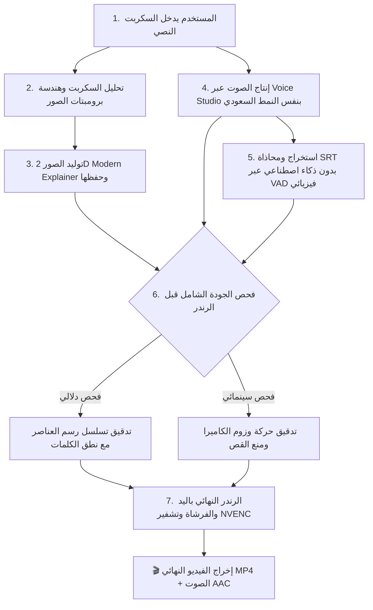

# 🎬 الدليل الشامل لهندسة خط إنتاج الفيديو الكامل (Master Video Production Pipeline)
**المشروع:** Storyboard to Whiteboard Animation Platform  
**الإصدار:** 2.0 (Production-Ready Architecture)  
**النوع:** وثيقة تشغيل وتصميم معيارية (Standard Operating Procedure - SOP)  

---

## 📌 الفهرس العام
1. [نظرة عامة على دورة الإنتاج ومخطط التدفق (Architecture & Workflow)](#1-نظرة-عامة-على-دورة-الإنتاج-ومخطط-التدفق)
2. [المرحلة 1: إدخال وتحليل السكربت النصي (Script Ingestion & Analysis)](#2-المرحلة-1-إدخال-وتحليل-السكربت-النصي)
3. [المرحلة 2: هندسة برومبتات توليد الصور الستوريبورد (AI Image Prompts Generation)](#3-المرحلة-2-هندسة-برومبتات-توليد-الصور-الستوريبورد)
4. [المرحلة 3: إنتاج التعليق الصوتي الاستوديو (Voice Studio Narration)](#4-المرحلة-3-إنتاج-التعليق-الصوتي-الاستوديو)
5. [المرحلة 4: استخراج ومطابقة ملف الـ SRT الصوتي (Zero AI Acoustic Alignment)](#5-المرحلة-4-استخراج-ومطابقة-ملف-الـ-srt-الصوتي)
6. [المرحلة 5: بوابات التدقيق الإلزامية قبل الرندر (Pre-Render Quality Gates)](#6-المرحلة-5-بوابات-التدقيق-الإلزامية-قبل-الرندر)
   - [البوابة A: التدقيق الدلالي لتسلسل رسم العناصر (Semantic Narrative Audit)](#البوابة-a-التدقيق-الدلالي-لتسلسل-رسم-العناصر)
   - [البوابة B: احترافية زوم وحركة الكاميرا السينمائية (Cinematic Camera & Zoom Audit)](#البوابة-b-احترافية-زوم-وحركة-الكاميرا-السينمائية)
7. [المرحلة 6: رندر الفيديو النهائي والتشفير العتادي (Full Video Rendering)](#7-المرحلة-6-رندر-الفيديو-النهائي-والتشفير-العتادي)
8. [دليل الأوامر السريعة والتشغيل التفاعلي (Execution Playbook)](#8-دليل-الأوامر-السريعة-والتشغيل-التفاعلي)

---

## 1. نظرة عامة على دورة الإنتاج ومخطط التدفق

تعتمد منصتنا على دورة إنتاج متكاملة ومنضبطة هندسياً لتحويل أي نص كتابي إلى فيديو Whiteboard Animation تفاعلي عالي الدقة (1080p/4K) متناسق صوتياً وبصرياً بنسبة 100%:



---

## 2. المرحلة 1: إدخال وتحليل السكربت النصي

### 📥 آلية الإدخال:
يُطلب من المستخدم تزويد النظام بالنص الكامل للسكربت وحفظه في المسار:
`project_content/transcript_to_speech.txt`

### 📋 متطلبات صياغة السكربت:
1. **وسوم الإيقاع والمشاعر (Tone Tags):**
   توضع في بداية كل فقرة لتوجيه أداء المعلق الصوتي، مثل:
   - `[energetic, fast]` : مقدمات حماسية وسريعة.
   - `[light, conversational]` : استراحات تأملية ونبرة حديث ودي.
   - `[serious, fast]` : مواضيع جادة ومعلومات علمية.
   - `[deep, intense]` : نقاط تحول درامية.
2. **علامات الترقيم الدقيقة:**
   - استخدام الفواصل `،` والنقاط `.` وعلامات الاستفهام `؟` بشكل دقيق لأنها تشكّل فيزيائياً فترات الصمت والتنفس للراوي ومحاور انقسام الترجمة (SRT).
3. **توزيع الفقرات:**
   - كل فقرة تكون بين 30 إلى 120 كلمة لتسهيل التقطيع المنطقي للشيتات واللوحات.

---

## 3. المرحلة 2: هندسة برومبتات توليد الصور الستوريبورد

### 🎨 الستايل البصري المعتمد (2D Modern Explainer / Kurzgesagt Aesthetic):
نبتعد تماماً عن ستايل الخربشات البدائية بالأبيض والأسود، ونعتمد الستايل الاحترافي المتجهي الكامل:
- **الخطوط:** خطوط سوداء متجهة عريضة ونظيفة (Crisp bold vector outlines).
- **الألوان:** باليت ألوان عصرية ومدروسة (Teal `#008080`, Warm Amber `#FFBF00`, Navy Blue `#000080`, Coral `#FF7F50`, Emerald `#50C878`).
- **الخلفية:** خلفية بيضاء نقية 100% (`RGB 255, 255, 255`) خالية من أي ظلال عامة أو خامات ورقية لتسهيل تقطيع العناصر ورسمها بفرشاة الفنان.
- **التصميم:** شخصيات معبرة واستعارات بصرية واضحة تحترم الجمهور.

### 📐 هندسة اللوحات والشيتات:
- يُقسّم الفيديو إلى **شيتات رئيسية (Sheets)**، كل شيت يحتوي على **6 لوحات (3 أعمدة × صفين)** بدقة 4K.
- مدة كل لوحة في المتوسط **15 إلى 25 ثانية**.
- يتم توليد ملف التوجيهات: `storyboard_prompts.md` أو الجدول الشامل في `ai_ansower.md`.

### 📝 قالب البرومبت الموحد (Master Prompt Template):
```text
A premium 2D modern explainer animation storyboard panel, full vibrant colors, clean flat vector art, cel-shaded illustration, Kurzgesagt-inspired aesthetic. Crisp bold black vector outlines, rich harmonious colors teal, warm amber, navy blue, coral, emerald, pure white background RGB 255 255 255, zero paper grain, zero shadows. Depict [الوصف البصري الدقيق للشخصية والاستعارة مع النص داخل اللوحة], expressive composition, ultra-clean studio quality, 4K digital art.
```

---

## 4. المرحلة 3: إنتاج التعليق الصوتي الاستوديو

### 🎙️ محرك الصوت المعتمد:
يتم تشغيل `voice_studio/batch_narrator.py` بالخصائص القياسية التالية:
- **الموديل الصوتي:** `gemini-2.5-flash-preview-tts` (أو النسخة الصوتية المعتمدة).
- **اسم الصوت:** `Fenrir` (أو الصوت المعتمد للهوية).
- **البروفايل:** `SAUDI_YOUTH_CREATOR` (شاب سعودي، عفوي، سريع، إيقاع يوتيوب حماسي، مخارج حروف واضحة).
- **ملاحظة المخرج:** `HIGH_ENERGY_YOUTUBE` (طاقة عالية، تنويع طبقات الصوت، بدون جمود إذاعي).

### ⚙️ إعدادات الحماية والتجميع:
- تأخير زمني بين الأقسام لحماية الـ API Rate Limits (`delay_between_sections: 12.0s`).
- فواصل توقف طبيعية بين الأقسام (`pause_between_sections: 0.25s` أو مدمجة تلقائياً).
- حفظ الأقسام المنفردة في `project_content/audio/chunks/` والمسار المجمع في `master_voiceover_concatenated.wav`.

---

## 5. المرحلة 4: استخراج ومطابقة ملف الـ SRT الصوتي

> [!IMPORTANT]
> **قاعدة صارمة:** ممنوع استخدام الذكاء الاصطناعي في استخراج وتوقيت ملف الـ SRT لضمان عدم حدوث أي انحراف زمني أو تخمين عشوائي.

### 🔬 آلية المعالجة الصوتية الحتمية (Zero AI Acoustic Engine):
يتم تشغيل الأداة البرمجية الحتمية:
```powershell
python generate_accurate_srt.py
```

### كيف تضمن الأداة دقة 100%؟
1. **كشف الصمت الفيزيائي (Physical VAD):**
   - استخدام فلتر `ffmpeg silencedetect=noise=-28dB:d=0.18` لفحص موجات الـ PCM الصوتية واستخراج بدايات ونهايات النطق الفعلي بدقة الميلي ثانية.
2. **البرمجة الديناميكية (Viterbi Monotonic Alignment):**
   - مطابقة نصوص العبارات الـ 414 مع فترات النطق بناءً على سرعة الكلام الواقعية (11 إلى 14 حرف/ثانية).
   - ربط الفواصل والنقاط بفترات التوقف الصوتي، وتوزيع الكلمات المتصلة داخل النبضة الصوتية الواحدة بنسب أوزان أحرفها.
3. **المخرجات المعتمدة:**
   - الملف الرئيسي: [project_content/srt/combined_subtitles.srt](file:///e:/image_to_animate/project_content/srt/combined_subtitles.srt) (يبدأ بالضبط عند أول صوت وينتهي عند آخر كلمة).
   - الملفات المنفصلة: [project_content/srt/sections/](file:///e:/image_to_animate/project_content/srt/sections/).

---

## 6. المرحلة 5: بوابات التدقيق الإلزامية قبل الرندر

قبل الضغط على زر الرندر، يجب اجتياز بوابتي تدقيق إلزاميتين لضمان الاحترافية الفائقة:

---

### البوابة A: التدقيق الدلالي لتسلسل رسم العناصر (Semantic Narrative Audit)
- **الهدف:** التأكد من أن اليد ترسم العنصر في نفس الثانية التي ينطق فيها المعلق اسمه.
- **الأداة:** `kivy/engine/pipeline/semantic_narrative_auditor.py`.
- **معايير الفحص:**
  1. **التطابق الزمني الصوتي:** ممنوع رسم عنصر متقدم قبل ذكره في الصوت (مثال: في لوحة المهام الروتينية، يُرسم ارتداء الملابس أولاً عند ثانية 36، ثم عربة التسوق عند ثانية 39، ثم عامل التوصيل عند ثانية 41.5، ثم الرعاية عند ثانية 45).
  2. **تسلسل التضاد:** في اللوحات التي تحتوي مقارنة (مثل الضغوط مقابل العيش في اللحظة)، تُرسم سحابة الضغوط والرسائل أولاً، ثم تُرسم الشخصية المسترخية على العشب عند نطق «يعيش اللحظة».
  3. **إعادة الترتيب التلقائي:** يتم تعديل مصفوفة ترتيب العناصر (`objects`) تلقائياً وإصلاح أي خلل قبل إرسالها لمحرّك الرسم.

---

### البوابة B: احترافية زوم وحركة الكاميرا السينمائية (Cinematic Camera & Zoom Audit)
- **الهدف:** ضمان تركيز المشاهد على اللوحة النشطة بنعومة تامة دون اهتزاز وبدون قص حواف العناصر.
- **الأداة:** `kivy/engine/render/viewport_transform.py` و `render_sheet1_preview.py`.
- **معايير الفحص:**
  1. **معامل التكبير المتوازن (Zoom Scale):**
     - التكبير على اللوحة الفردية يكون بين `1.32x` إلى `2.10x` بحسب حجم اللوحة لملء شاشة الـ 16:9 بنسبة 85% على الأقل.
     - هوامش أمان (Safe Margins) بمقدار 40 بكسل على الأقل من كافة الجهات لضمان عدم خروج يد الرسام أو النصوص خارج الإطار.
  2. **منحنى الانتقال الانسيابي (Smootherstep / Bezier Easing):**
     - عند انتقال الحديث من لوحة إلى أخرى، تتحرك الكاميرا بمنحنى ناعم:
       $$S(t) = 6t^5 - 15t^4 + 10t^3$$
       مما يمنح حركة كاميرا كامبروز ناعمة تبدأ ببطء وتتسارع بسلاسة وتتوقف بلطف.
  3. **المشهد الختامي العظيم (Grand Outro Reveal):**
     - في آخر 3 إلى 4 ثوانٍ من الشيت، تتراجع الكاميرا للخلف بسلاسة (Zoom-Out إلى `0.95x` أو `1.0x`) لتكشف الشيت كاملاً بجميع لوحاته الست مرسومة كتحفة فنية واحدة متكاملة.

---

## 7. المرحلة 6: رندر الفيديو النهائي والتشفير العتادي

### 🎬 محرك الرندر المعتمد:
يتم استدعاء `render_sheet1_preview.py` (أو سكربت الشيت المعني) لتنفيذ:
1. **محاكاة الرسم الطبيعي:**
   - تقشير الحواف الخارجية والداخلية للشخصيات بفرشاة الفنان (Concentric Contour Peeling).
   - كتابة النصوص بخط اليد العربي من اليمين لليسار (RTL Handwriting Skeleton).
2. **طبقة اليد الواقعية (Real Hand Overlay):**
   - تثبيت سن القلم عند نقطة الحبر النشطة بزاوية مريحة لا تحجب الرسم عن المشاهد.
3. **التشفير الفائق عبر كرت الشاشة (GPU NVENC):**
   - استخدام `h264_nvenc` بمستوى جودة ثابت (`cq: 19`, preset `p5`) أو `CPU h264` (`crf: 18`) لإنتاج أعلى نقاء بصري بدقة 1080p @ 30fps.
4. **الدمج الصوتي الصافي (Lossless AAC Muxing):**
   - دمج مسار الصوت مباشرة داخل حاوية الـ MP4 دون إعادة ضغط مهدرة للجودة.

---

## 8. دليل الأوامر السريعة والتشغيل التفاعلي (Execution Playbook)

| الخطوة | الأمر البرمجي | الوظيفة |
| :--- | :--- | :--- |
| **1. فحص الصوت والأقسام** | `python scratch/inspect_alignment.py` | التأكد من وجود كافة ملفات WAV ومطابقتها لأقسام السكربت. |
| **2. توليد وضبط SRT الصوتي** | `python generate_accurate_srt.py` | استخراج وتوقيت ملف SRT بدقة الميلي ثانية وبدون ذكاء اصطناعي. |
| **3. التحقق من مطابقة SRT** | `python scratch/check_srt.py` | التأكد من انعدام أي انحراف زمني وتطابق البداية والنهاية. |
| **4. الفحص الدلالي والكاميرا** | `python -m kivy.engine.pipeline.semantic_narrative_auditor` | مراجعة تسلسل رسم العناصر والكاميرا قبل الرندر. |
| **5. الرندر النهائي للفيديو** | `python render_sheet1_preview.py` | إنتاج الفيديو الكامل بدقة 1080p مع الصوت والمؤثرات. |

---

> [!TIP]
> **ملاحظة للمطورين وصناع المحتوى:** هذا الملف يمثل المرجع المعماري المعتمد للمشروع. أي إضافة لشيت جديد أو سكربت جديد يجب أن تتبع هذه المراحل الست بدقة لضمان الحفاظ على الجودة السينمائية والتطابق التام بين الصوت والرسم.
