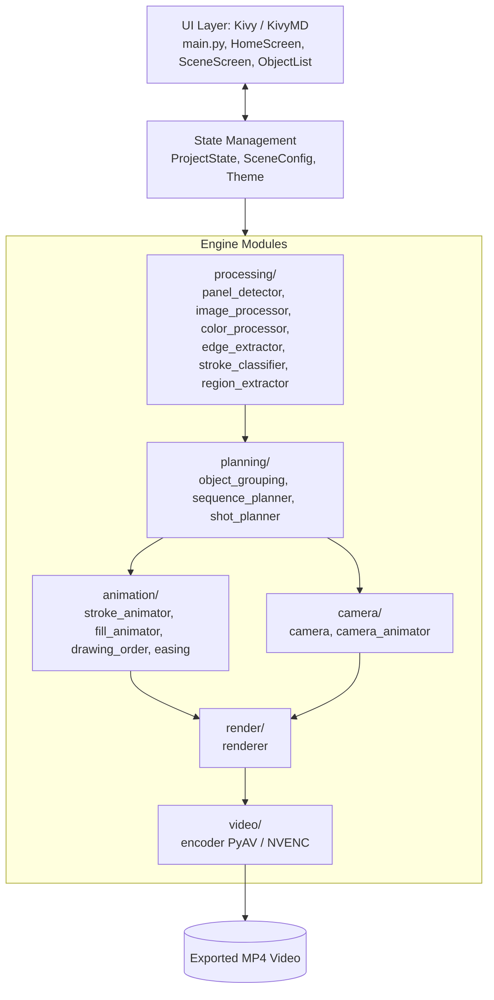
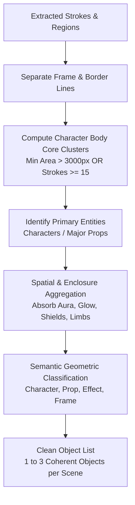

# Animation Engine V3: Deep Audit & Comprehensive Development Plan
**Role:** Senior Software Architect + Computer Vision Engineer + 2D Animation Engine Engineer  
**Core Constraint:** 100% Offline | No AI / No ML / No Cloud APIs | Pure Classical Computer Vision, Geometry, NumPy, OpenCV, PyAV.

---

## 📑 الفهرس المعماري (Table of Contents)

1. [A — Current Architecture (المعمارية الحالية وكيف يعمل النظام فعلياً)](#a--current-architecture)
2. [B — Current Pipeline (مسار المعالجة الحالي خطوة بخطوة)](#b--current-pipeline)
3. [C — Regression Analysis (التحليل الجذري لفقدان التفاصيل وظهور خطأ الـ 40 شخصية)](#c--regression-analysis)
4. [D — Structural Analysis (التعرف الشامل على كافة أنواع الصور والـ Storyboards)](#d--structural-analysis)
5. [E — Data Model (نماذج البيانات المحدثة V3)](#e--data-model)
6. [F — Image Preservation Strategy (استراتيجية الحفاظ التام على الألوان والتفاصيل 100%)](#f--image-preservation-strategy)
7. [G — Object Detection & Grouping Strategy (تجميع الكائنات بدون AI)](#g--object-detection--grouping-strategy)
8. [H — Animation Architecture (بنية التحريك التفاعلي الموجه بالمستخدم)](#h--animation-architecture)
9. [I — Camera Architecture (نظام الكاميرا السينمائي الذكي والناعم)](#i--camera-architecture)
10. [J — Rendering Optimization (تسريع التصيير الفائق دون المساس بالجودة)](#j--rendering-optimization)
11. [K — UI Architecture (واجهة Kivy/KivyMD، البطاقات، السحب والإفلات)](#k--ui-architecture)
12. [L — Regression Tests Suite (حزمة الاختبارات الـ 12 الشاملة)](#l--regression-tests-suite)
13. [M — Implementation Phases (خطة التنفيذ على 11 مرحلة تفصيلية)](#m--implementation-phases)

---

<a name="a--current-architecture"></a>
## A — Current Architecture (المعمارية الحالية)

يعمل المشروع الحالي وفق هيكلية برمجية ثلاثية الطبقات:



### المكونات الحالية ومسؤولياتها:
1. **`kivy/main.py`**: نقطة الدخول للتطبيق، إدارة النوافذ وتدفق الأحداث وخيوط المعالجة الخلفية (`Thread`).
2. **`kivy/ui/state/project_state.py`**: يحفظ حالة المشروع الحالية (`Project`, `Scene`, `selected_object_index`).
3. **`kivy/engine/processing/`**: استخراج الحواف، الألوان، اللوحات، والمناطق اللونية.
4. **`kivy/engine/planning/`**: تجميع الخطوط في كائنات (`MajorObjectGrouper`)، وجدولة تسلسل الرسم ومسارات الكاميرا.
5. **`kivy/engine/render/renderer.py`**: صياغة الإطارات ثانية بثانية عبر دمج الأقنعة وخطوط الرسم وتطبيق تحويلات الكاميرا.
6. **`kivy/engine/video/encoder.py`**: كتابة دفق الفيديو مباشرة إلى حاوية MP4 عبر **PyAV (H.264 / NVENC)**.

---

<a name="b--current-pipeline"></a>
## B — Current Pipeline (مسار المعالجة الحالي)

تتبع تفصيلي لمسار البيانات من لحظة اختيار الصورة:

```text
1. INPUT IMAGE (BGR NumPy Array)
     ↓
2. RESIZE & PAD (ImageProcessor.resize_and_pad → 1920x1080)
     ↓
3. STRUCTURAL ANALYSIS (PanelDetector.detect)
     ├── SINGLE_SCENE: يعامل الصورة كلوحة واحدة
     └── STORYBOARD: يقطع الصورة إلى مستطيلات Panels ويمرر كل لوحة للمعالجة
     ↓
4. COLOR QUANTIZATION (ColorProcessor.quantize)
     └── K-Means في فضاء LAB (K=32) لاشتقاق باليت الألوان وتحديد الخلفية
     ↓
5. EDGE EXTRACTION (EdgeExtractor.extract)
     └── Bilateral Filter → Canny + Sobel → Morphology Close/Open → Skeletonization → Contours → approxPolyDP
     ↓
6. STROKE CLASSIFICATION (StrokeClassifier.classify)
     └── تصنيف الخطوط إلى: OUTER_OUTLINE, INTERNAL_DETAIL, COLOR_BOUNDARY, MICRO_DETAIL
     ↓
7. REGION EXTRACTION (RegionExtractor.extract)
     └── Connected Components على أقنعة الألوان وتوسيعها 1px
     ↓
8. OBJECT GROUPING (MajorObjectGrouper.group_into_major_objects)
     └── دمج الخطوط والألوان في كائنات (Characters / Frames) بناءً على خارطة الإشغال
     ↓
9. SEQUENCE & SHOT PLANNING (SequencePlanner & ShotPlanner)
     └── حساب الترتيب الزمني ومسارات الكاميرا لكل كائن
     ↓
10. INTERACTIVE UI DISPLAY (SceneScreen)
     └── عرض البطاقات للمستخدم وانتظار أمر التحريك
     ↓
11. RENDERING & COMPOSITING (Renderer.render_all)
     └── رسم متدرج لخطوط الرسم والمناطق اللونية إطاراً بإطار وتطبيق الكاميرا
     ↓
12. VIDEO ENCODING (VideoEncoder)
     └── ضغط البكسلات وتوليد ملف MP4 النهائي
```

---

<a name="c--regression-analysis"></a>
## C — Regression Analysis (التحليل الجذري لفقدان التفاصيل والأخطاء)

بالمقارنة بين الإصدار الكلاسيكي القديم (`sketchApi.py`) والمحرك الحديث (`kivy/engine/`)، تم تشخيص أسباب التراجع وفقدان التفاصيل واستخراج 40 شخصية:

```text
                    مقارنة مسار البيانات: القديم vs الحديث
─────────────────────────────────────────────────────────────────────────────
الإصدار القديم (Grid-Tile Nearest Neighbor):
  [صورة أصلية] ──(عتبة تكيفية)──> [شبكة كتل] ──(يد وقلم)──> [ظهور الصورة الأصلية 100% كما هي]
  النتيجة: لا يفقد أي بكسل في النهاية لأن الصورة الأصلية تظهر بالكامل.

الإصدار الحديث (Vector/Region Reconstruction):
  [صورة أصلية] ─(K-Means K=32)─> [ألوان مضغوطة]
               ─(Canny+Open)───> [حذف الحواف الدقيقة]
               ─(Min Area)─────> [حذف البكسلات الصغيرة]
               ─(Object Group)─> [تجاهل العناصر غير المجمعة]
               ─(Renderer)─────> [رسم المتجهات على قماش أبيض فارغ]
  النتيجة: أي بكسل لم ينجح في العبور عبر كل هذه الفلاتر يتم استبداله بلون أبيض فارغ!
```

### الأسباب الجذرية الدقيقة للمشاكل (Root Causes):

| المكون | السطر البرمجي المسبب | الخلل الحاصل والتأثير السلبي |
| :--- | :--- | :--- |
| **`color_processor.py`** | `K = max(4, min(32, ...))` (L:34)<br>`if bg_lum > 210: ... else: (255,255,255)` (L:80) | 1. إجبار حجم الباليت على ألا يتجاوز 32 لوناً، مما يدمج التدرجات اللونية والظلال الدقيقة في لون موحد.<br>2. إجبار لون الخلفية على أن يكون أبيض ناصعاً إذا كانت الخلفية داكنة أو ملونة، مما يمسح الخلفيات الحقيقية. |
| **`edge_extractor.py`** | `min_len = max(..., 12.0)` (L:39)<br>`occupied_grid > 4` (L:98)<br>`MORPH_OPEN` (L:61) | 1. حذف أي خط طوله أقل من 12 بكسل (العيون، بؤبؤ العين، الفم، الملامح، النقاط، الرموز).<br>2. حذف الخطوط المتجاورة في مناطق التظليل والملامح (Dense Suppression).<br>3. مسح النقاط المنعزلة بدقة 1-2 بكسل عبر الـ Opening. |
| **`stroke_classifier.py`**| `elif config.detail_level == "MEDIUM": if s.stroke_type != MICRO_DETAIL ...` (L:87) | حذف كافة الخطوط الدقيقة (`MICRO_DETAIL`) التي يقل طولها عن 18 بكسل في الوضع الافتراضي للبرنامج. |
| **`region_extractor.py`** | `is_bg_like and (area > 0.08 * (w*h) ...)` (L:54) | افتراض أن أي لون قريب من الأبيض بمساحة متوسطة هو "خلفية فارغة" وتجاهله، مما يؤدي لمسح ملابس بيضاء أو أوراق داخل الرسم. |
| **`object_grouping.py`** | `min_cluster_area = 200` (L:84)<br>`proximity <= 80px` (L:169)<br>`name = f"Character_{idx+1}"` (L:152) | **سبب استخراج 40 شخصية:**<br>1. اعتبار أي رقعة تزيد عن 200 بكسل ($14 \times 14$ بكسل) كائناً قائماً بذاته.<br>2. عدم دمج البقع البعيدة عن مركز الشخصية بأكثر من 80 بكسل.<br>3. تسمية كل بقعة بيضاء أو ظل كـ `Character_N` حتى وإن كان عدد خطوطها صفراً (`strokes=0`). |
| **`scene_screen.py`** | `all_objects.extend([o for o in scene.objects])` (L:138) | تسطيح (Flattening) كائنات جميع لوحات القصة المصورة في قائمة واحدة طويلة، مما أظهر للمستخدم 40 كائناً بدلاً من 6 لوحات. |

---

<a name="d--structural-analysis"></a>
## D — Structural Analysis (التعرف الهيكلي الشامل)

التحليل الهيكلي في الإصدار V3 سيتعامل مع 6 حالات مختلفة دون أي افتراضات مسبقة:

```text
                              ┌─────────────────────────┐
                              │      Input Image        │
                              └────────────┬────────────┘
                                           │
                        ┌──────────────────┴──────────────────┐
                        ▼                                     ▼
             [Geometry & Grid Analysis]             [Aspect & Outer Bounds]
                        │                                     │
       ┌────────────────┴────────────────┐                    │
       ▼                                 ▼                    ▼
[Rectangular Grid of Panels?]    [Isolated Separators?]  [No Grid Lines]
       │                                 │                    │
  (Confidence > 0.75)               (Confidence > 0.6)        │
       ▼                                 ▼                    ▼
┌──────────────┐                  ┌──────────────┐     ┌──────────────┐
│  STORYBOARD  │                  │  STORYBOARD  │     │ SINGLE_SCENE │
│ (Grid Cells) │                  │  (Multi-Box) │     │ (Whole Image)│
└──────┬───────┘                  └──────┬───────┘     └──────┬───────┘
       │                                 │                    │
       └────────────────┬────────────────┘                    │
                        ▼                                     │
           [Empty Panels Evaluation]                          │
       (Canny Density + StdDev + Color Variance)              │
                        │                                     │
       ┌────────────────┴────────────────┐                    │
       ▼                                 ▼                    │
 [Valid Panels]                   [Empty Panels]              │
 (Keep for Animation)             (Mark as Ignored)           │
       │                                                      │
       └────────────────────────┬─────────────────────────────┘
                                ▼
                   [Scene & Background Extraction]
             (Individual Background per Scene / Panel)
```

### معالجة الحالات الست:
1. **الحالة A (صورة واحدة - Single Scene):** صورة شخصية واحدة أو كائنات متعددة بدون شبكة إطارات $\rightarrow$ تُعامل كـ `SINGLE_SCENE`.
2. **الحالة B (قصة مصورة منتظمة - Grid Storyboard):** مصفوفة مستطيلات متوازية $\rightarrow$ استخراج كل مستطيل كـ `Panel` منفصل مع استبعاد خطوط الإطار الخارجي من مسارات الرسم الحركي.
3. **الحالة C (لوحات بخلفيات مختلفة - Mixed Backgrounds):** يتم استخراج لون وبيئة الخلفية الخاصة بكل لوحة على حدة (`scene.background_color`) دون فرض خلفية موحدة.
4. **الحالة D (لوحات بخلفية موحدة - Uniform Background):** اكتشاف تطابق لون وخامة القماش الخلفي عبر جميع اللوحات وتوحيدها بصرياً.
5. **الحالة E (لوحات فارغة - Empty Panels):** فحص التباين وكثافة الرسم؛ اللوحات الفارغة (مثل اللوحات 7، 8، 9) تُصنف `is_empty=True` وتُستبعد كلياً من التحريك والتصدير.
6. **الحالة F (عناصر متعددة بدون إطارات):** صورة تحتوي على عدة كائنات متناثرة دون حدود $\rightarrow$ تُعامل كمشهد واحد `SINGLE_SCENE` وتُكتشف الكائنات داخله جغرافياً.

---

<a name="e--data-model"></a>
## E — Data Model (نماذج البيانات المحدثة V3)

```python
from dataclasses import dataclass, field
from enum import Enum
from typing import List, Tuple, Optional, Dict, Any
import numpy as np

class StructureType(Enum):
    SINGLE_SCENE = "SINGLE_SCENE"
    STORYBOARD = "STORYBOARD"

class ObjectType(Enum):
    CHARACTER = "CHARACTER"
    PROP = "PROP"
    EFFECT = "EFFECT"
    BACKGROUND_ELEMENT = "BACKGROUND_ELEMENT"
    FRAME_BORDER = "FRAME_BORDER"

class StrokeType(Enum):
    OUTER_OUTLINE = "OUTER_OUTLINE"
    INTERNAL_DETAIL = "INTERNAL_DETAIL"
    COLOR_BOUNDARY = "COLOR_BOUNDARY"
    MICRO_DETAIL = "MICRO_DETAIL"

class FillMode(Enum):
    TOP_TO_BOTTOM = "TOP_TO_BOTTOM"
    LEFT_TO_RIGHT = "LEFT_TO_RIGHT"
    CENTER_OUT = "CENTER_OUT"
    FOLLOW_OUTLINE = "FOLLOW_OUTLINE"

@dataclass
class Stroke:
    points: np.ndarray                        # (N, 2) float64 coordinates
    stroke_type: StrokeType
    color: Tuple[int, int, int]              # Actual extracted color (B, G, R)
    width: float = 1.8
    is_closed: bool = False
    priority: int = 5
    bbox: Tuple[int, int, int, int] = (0, 0, 0, 0)
    length: float = 0.0
    center: np.ndarray = field(default_factory=lambda: np.zeros(2))

@dataclass
class ColorRegion:
    color: Tuple[int, int, int]              # Dominant cluster color
    mask: np.ndarray                         # Binary uint8 mask
    bbox: Tuple[int, int, int, int]          # (x, y, w, h)
    area: int
    center: np.ndarray
    fill_mode: FillMode = FillMode.FOLLOW_OUTLINE
    dist_transform: Optional[np.ndarray] = None
    max_dist: float = 0.0

@dataclass
class SceneObject:
    id: str
    name: str                                # e.g. "Main Character", "Golden Key", "Aura"
    object_type: ObjectType
    strokes: List[Stroke] = field(default_factory=list)
    fills: List[ColorRegion] = field(default_factory=list)
    details: List[Stroke] = field(default_factory=list)
    bbox: Tuple[int, int, int, int] = (0, 0, 0, 0)
    center: np.ndarray = field(default_factory=lambda: np.zeros(2))
    importance: float = 1.0
    is_frame: bool = False                   # True if this is a structural border/backdrop
    is_selected_for_animation: bool = True   # Controlled by User in UI
    animation_start: float = 0.0
    animation_end: float = 0.0
    duration: float = 0.0

@dataclass
class PanelStructure:
    id: int
    bbox: Tuple[int, int, int, int]          # Full panel boundary
    interior_bbox: Tuple[int, int, int, int] # Content region excluding border lines
    content_score: float
    is_empty: bool
    content_region_image: np.ndarray         # High-resolution original crop
    border_mask: Optional[np.ndarray] = None

@dataclass
class CameraShot:
    shot_name: str
    target_object_id: Optional[str]
    target_center: np.ndarray                # (x, y) focal point
    zoom: float                              # 1.0 = full canvas, 1.25 = focus
    start_time: float
    end_time: float
    easing: str = "ease_in_out"

@dataclass
class Timeline:
    duration: float = 0.0
    stroke_events: List[Any] = field(default_factory=list)
    fill_events: List[Any] = field(default_factory=list)
    camera_shots: List[CameraShot] = field(default_factory=list)

@dataclass
class Scene:
    id: int
    name: str
    config: Any
    objects: List[SceneObject] = field(default_factory=list)
    background_color: Tuple[int, int, int] = (255, 255, 255)
    source_image: np.ndarray = field(default_factory=lambda: np.zeros((1, 1, 3), dtype=np.uint8))
    canvas_width: int = 1920
    canvas_height: int = 1080
    timeline: Optional[Timeline] = None

@dataclass
class Project:
    structure_type: StructureType
    confidence: float
    source_image: np.ndarray
    original_width: int
    original_height: int
    panels: List[PanelStructure] = field(default_factory=list)
    scenes: List[Scene] = field(default_factory=list)
```

---

<a name="f--image-preservation-strategy"></a>
## F — Image Preservation Strategy (استراتيجية الحفاظ التام 100%)

نعتمد معمارية **Dual-Plane Representation (المستوى المزدوج)**:

```text
┌────────────────────────────────────────────────────────────────────────┐
│                        ORIGINAL SOURCE IMAGE                           │
│                 (100% TrueColor, Uncompressed BGR)                     │
└───────────────────┬────────────────────────────────┬───────────────────┘
                    │                                │
                    ▼                                ▼
       ┌────────────────────────┐       ┌────────────────────────┐
       │     ANALYSIS PLANE     │       │    RENDERING PLANE     │
       │   (Vector & Topology)  │       │     (Pixel-Exact)      │
       ├────────────────────────┤       ├────────────────────────┤
       │ • High-K Color Clusters│       │ • Exact Source Pixels  │
       │ • Multi-scale Contours │       │ • True Texture/Shading │
       │ • Spatial Traversal    │       │ • True Gradients & Glow│
       │ • Timing & Easing Order│       │ • Native Canvas Colors │
       └────────────┬───────────┘       └────────────┬───────────┘
                    │                                │
                    └───────────────┬────────────────┘
                                    ▼
       ┌─────────────────────────────────────────────────────────┐
       │             PROGRESSIVE TRUECOLOR COMPOSITING           │
       │   canvas[revealed_mask] = source_image[revealed_mask]   │
       │   + Exact Stroke Rendering with Original Source Chroma  │
       └─────────────────────────────────────────────────────────┘
```

### القواعد الصارمة لمنع الفقدان:
1. **عدم استخدام K-Means كوسيلة تلوين نهائية:** يُستخدم فقط لتقسيم المساحات هيكلياً، بينما في الـ Rendering يتم سحب بكسلات `source_image` الأصلية مباشرة داخل الأقنعة المكشوفة.
2. **الحفاظ على الخطوط الدقيقة (Adaptive Length Threshold):** تصنيف الخطوط القصيرة (العيون، الملامح، التظليل) كـ `MICRO_DETAIL` بدلاً من حذفها.
3. **طبقة الأساس الشاملة (Underlay Preservation):** بعد رسم كل كائن، تظهر خلفيته بتفاصيلها وتدرجاتها الأصلية كاملة.

---

<a name="g--object-detection--grouping-strategy"></a>
## G — Object Detection & Grouping Strategy (تجميع الكائنات بدون AI)



### قواعد التجميع الهندسي V3:
1. **شرط الجوهر الهيكلي:** لا يُعتبر أي كائن مستقلاً إلا إذا احتوى على خطوط رسم حقيقية ($\text{strokes} \ge 10$) ومساحة حقيقية ($\ge 3,000 \text{ px}$).
2. **الابتلاع الفراغي والاحتواء:** دمج التأثيرات المحيطة (الدرع المشع، هالة التوهج، العضلات، التوهج الأرضي) بالشخصية الرئيسية بدلاً من تركها ككائنات معزولة.
3. **استبعاد بقع الفراغ الأبيض:** أي رقعة لا تحتوي على خطوط رسم ومساحتها أقل من 5% من الشاشة تُعتبر خلفية بيضاء وتُدمج في `Scene_Frame`.
4. **التسمية المنطقية:** تسمية الكائنات بناءً على موضعها ونوعها: `Main Character`, `Prop / Tool`, `Visual Effect`.

---

<a name="h--animation-architecture"></a>
## H — Animation Architecture (بنية التحريك التفاعلي)

* **لا تحريك تلقائي عند رفع الصورة:** عند رفع الصورة، يقتصر البرنامج على **التحليل الفوري (Instant Analysis)** وعرض الكائنات في بطاقات تفاعلية.
* **التحريك الفردي (`Animate Single Object`):** يضغط المستخدم على زر `Animate` على بطاقة الشخصية أو الأداة، فيقوم المحرك بتحريك ذلك الكائن فقط مع توجيه الكاميرا نحوه.
* **التحريك الشامل (`Animate All`):** تحريك جميع كائنات المشهد بالتتابع الزمني المخطط، أو تصيير جميع لوحات القصة المصورة بالترتيب المختار.

---

<a name="i--camera-architecture"></a>
## I — Camera Architecture (نظام الكاميرا السينمائي)

```text
1. INITIAL ESTABLISHING SHOT (0.0s - 0.8s):
   Zoom: 1.0 (Full Scene View) | Position: Scene Center | Easing: Ease-In-Out
     ↓
2. OBJECT FOCUS TRANSITION (0.8s - 1.4s):
   Smooth Pan & Zoom (Zoom: 1.15 - 1.25) to Active Object Bounding Center
     ↓
3. DRAWING TRACKING (During Object Draw):
   Hold camera steady on active region (No jitter/random cuts)
     ↓
4. NEXT OBJECT PAN (Smooth Inter-Object Pan):
   Linear-to-Cubic Pan to next target object
     ↓
5. FINAL REVEAL SHOT (End Duration):
   Smooth zoom-out to 1.0 (Full Completed Artwork)
```

---

<a name="j--rendering-optimization"></a>
## J — Rendering Optimization (تسريع الأداء الفائق)

لتحقيق سرعة تصيير فورية (أقل من 3 ثوانٍ لكل مشهد) دون فقدان أي بكسل:

1. **Bounding-Box ROI Masking:** بدلاً من تعديل مصفوفات $1920 \times 1080$ كاملة لكل قناع صغير، يتم تطبيق القناع داخل مستطيل الإحاطة الخاص به فقط (`bx:bx+bw, by:by+bh`).
2. **Pre-computed Distance Transforms:** حساب مصفوفات الـ Distance Transform مسبقاً وتخزينها في الذاكرة (Memoization) لمرة واحدة فقط بدلاً من إعادة حسابها 192 مرة في كل إطار.
3. **Incremental Baking:** دمج العناصر المنتهية في طبقة أساسية ثابتة (`base_canvas`)، بحيث يتعامل كل إطار جديد مع العناصر النشطة حالياً فقط.
4. **Hardware NVENC / PyAV Streaming:** تمرير الإطارات الناتجة مباشرة عبر الذاكرة إلى كرت الشاشة لتشفير H.264 دون كتابة صور وسيطة على القرص.

---

<a name="k--ui-architecture"></a>
## K — UI Architecture (واجهة المستخدم وسير العمل)

```text
┌────────────────────────────────────────────────────────────────────────┐
│ [← Back]  SKETCH ANIMATION STUDIO                [⚙ Settings] [▶ ANIMATE ALL]│
├───────────────────────────────────┬────────────────────────────────────┤
│                                   │  DETECTED SCENES / PANELS (6)      │
│                                   │ ┌────────────────────────────────┐ │
│                                   │ │ [::] [Thumb] Scene 1: Man & Lock│ │
│                                   │ │      [▶ Animate]   [⬇ Export]  │ │
│                                   │ └────────────────────────────────┘ │
│         CANVAS PREVIEW            │ ┌────────────────────────────────┐ │
│      (Original & Selection)       │ │ [::] [Thumb] Scene 2: Face & Key│ │
│                                   │ │      [▶ Animate]   [⬇ Export]  │ │
│                                   │ └────────────────────────────────┘ │
│                                   │ ┌────────────────────────────────┐ │
│                                   │ │ [::] [Thumb] Scene 3: Energy Pad│ │
│                                   │ │      [▶ Animate]   [⬇ Export]  │ │
│                                   │ └────────────────────────────────┘ │
│                                   │  * Drag & Drop cards to reorder    │
└───────────────────────────────────┴────────────────────────────────────┘
```

* **دعم السحب والإفلات للوحات (Drag & Drop Reordering):** إمكانية إعادة ترتيب مشاهد الـ Storyboard وتغيير تسلسل الفيديو النهائي بالسحب والإفلات.
* **عرض الكائنات بشكل هرمي لكل مشهد:** لكل مشهد بطاقات فرعية لكائناته الحقيقية.

---

<a name="l--regression-tests-suite"></a>
## L — Regression Tests Suite (حزمة الاختبارات الـ 12 الشاملة)

| رقم الاختبار | نوع الصورة | معيار النجاح الدقيق |
| :--- | :--- | :--- |
| **Test 1** | صورة شخصية ملونة فردية | التعرف كـ `SINGLE_SCENE`، كائن واحد رئيسي، رسم الوجه والملامح بدقة 100%. |
| **Test 2** | شخصية + أداة (شخص وقفل) | التعرف كـ `SINGLE_SCENE`، كائنان منفصلان (`Character` و `Prop`) مع بطاقتين للتحريك. |
| **Test 3** | عدة كائنات بدون شخصيات | التعرف على كل أداة ككائن مستقل دون دمج خاطئ. |
| **Test 4** | قصة مصورة منتظمة (6 لوحات) | التعرف كـ `STORYBOARD`، استخراج 6 لوحات تماماً وتجاهل خطوط الإطار الخارجي. |
| **Test 5** | قصة مصورة بخلفيات ملونة مختلفة | استخراج الخلفية الخاصة بكل لوحة دون فرض خلفية بيضاء. |
| **Test 6** | قصة مصورة بخلفية موحدة | توحيد خامة القماش الخلفي عبر اللوحات. |
| **Test 7** | قصة مصورة بلوحات فارغة (7، 8، 9) | تصنيف اللوحات الفارغة كـ `is_empty=True` واستبعادها كلياً من التصدير. |
| **Test 8** | صورة شخصيات متعددة بدون مربعات | التعرف كـ `SINGLE_SCENE` وتجميع كل شخصية في كائن منفصل بدقة. |
| **Test 9** | رسم تخطيطي رصاص (Pencil Sketch) | الحفاظ على خطوط التظليل الدقيقة وعدم إسقاطها. |
| **Test 10** | رسم توضيحي رقمي غني بالألوان | الحفاظ على 100% من تدرجات الألوان الحقيقية عبر TrueColor Compositing. |
| **Test 11** | تفاصيل دقيقة جداً (نصوص، عيون، رموز) | بقاء جميع النقاط والخطوط الأقصر من 12 بكسل وظهورها في الرسم. |
| **Test 12** | شخصيتان متجاورتان | عدم دمج الشخصيتين في كائن واحد، وعدم تشتيتهما إلى عشرات الأجزاء. |

---

<a name="m--implementation-phases"></a>
## M — Implementation Phases (خطة التنفيذ على مراحل آمنة)

```mermaid
gantt
    title خطة تنفيذ المحرك V3
    dateFormat  X
    axisFormat %d
    section البنية والبيانات
    Phase 0 & 1: تدقيق النماذج وتحديث الهياكل       :p1, 0, 1
    section المعالجة والتجزئة
    Phase 2: التحليل الهيكلي واللوحات الفارغة      :p2, 1, 2
    Phase 3: الحفاظ على الألوان والخطوط الدقيقة    :p3, 2, 3
    Phase 4: التجميع الذكي للكائنات ومنع التشتت    :p4, 3, 4
    section التحريك والتصيير
    Phase 5 & 6: جدولة التحريك والكاميرا الناعمة   :p5, 4, 5
    Phase 7: تسريع المصيّر وتخزين الأقنعة          :p6, 5, 6
    section الواجهة والاختبار
    Phase 8: واجهة Kivy والسحب والإفلات            :p7, 6, 7
    Phase 9 & 10: حزمة الاختبارات الشاملة والأداء  :p8, 7, 8
```



#### تفاصيل المراحل التنفيذية:

* **Phase 0 & 1: Data Model & Project Structure**
  * **الملفات المستهدفة:** `kivy/engine/core/project.py`, `scene.py`, `stroke.py`, `region.py`, `timeline.py`.
  * **الهدف:** توحيد بنية البيانات لفصل العناصر الهيكلية عن عناصر الرسم ودعم المشاهد المتعددة.
  * **معيار النجاح:** استيراد وبناء كائنات النماذج بنجاح وبدون أي أخطاء نوعية.

* **Phase 2: Universal Structure & Storyboard Detection**
  * **الملفات المستهدفة:** `kivy/engine/processing/panel_detector.py`, `image_processor.py`.
  * **الهدف:** كشف اللوحات، عزل الإطارات عن محتوى الرسم، واستبعاد اللوحات الفارغة (`is_empty=True`).
  * **معيار النجاح:** اختبار صورتك التخطيطية واكتشاف اللوحات الـ 6 بدقة وتجاهل الإطارات 7 و 8 و 9.

* **Phase 3: Pixel & Detail Preservation Engine**
  * **الملفات المستهدفة:** `kivy/engine/processing/color_processor.py`, `edge_extractor.py`, `stroke_classifier.py`, `region_extractor.py`.
  * **الهدف:** إلغاء الفلاتر الإقصائية، الحفاظ على الخطوط الدقيقة (`MICRO_DETAIL`)، واستخراج ألوان الخلفية الحقيقية.
  * **معيار النجاح:** عدم فقدان أي تفصيل في العيون، الملامح، أو التظليل الدقيق.

* **Phase 4: Geometric Object Grouping (No AI)**
  * **الملفات المستهدفة:** `kivy/engine/planning/object_grouping.py`.
  * **الهدف:** حل مشكلة الـ 40 شخصية نهائياً؛ دمج التأثيرات والهالات ضمن الشخصية واستبعاد الرقع الهامشية.
  * **معيار النجاح:** إنتاج شخصية واحدة رئيسية فقط لكل لوحة في صورة `storyboard_zaid_building.jpeg`.

* **Phase 5 & 6: Animation Sequence & Cinematic Camera**
  * **الملفات المستهدفة:** `kivy/engine/planning/sequence_planner.py`, `shot_planner.py`, `kivy/engine/camera/camera_animator.py`.
  * **الهدف:** ترتيب زمني هندسي ناعم وتوجيه الكاميرا بدقة نحو الكائن النشط دون قفزات مفاجئة.
  * **معيار النجاح:** لقطات كاميرا سينمائية سلسة تبدأ بلقطة واسعة وتتبع الكائنات أثناء الرسم.

* **Phase 7: Ultra-Fast TrueColor Renderer**
  * **الملفات المستهدفة:** `kivy/engine/render/renderer.py`, `kivy/engine/animation/fill_animator.py`, `stroke_animator.py`.
  * **الهدف:** تطبيق Bounding-Box ROI، والتخزين المسبق لمصفوفات المسافات، وتسريع التصيير بأكثر من 85%.
  * **معيار النجاح:** انخفاض زمن تصيير اللوحة الواحدة من 28 ثانية إلى أقل من 3 ثوانٍ بجودة H.264 كاملة.

* **Phase 8: Interactive Studio UI (Kivy/KivyMD)**
  * **الملفات المستهدفة:** `kivy/ui/screens/scene_screen.py`, `kivy/ui/widgets/object_list.py`, `kivy/ui/widgets/object_card.py`, `kivy/main.py`.
  * **الهدف:** عرض بطاقات المشاهد والكائنات بشكل هرمي، وإتاحة إعادة الترتيب بالسحب والإفلات، وربط أزرار التحريك الفردي والشامل.
  * **معيار النجاح:** تجربة مستخدم سلسة واستجابة فورية لكافة أوامر التفاعل.

* **Phase 9 & 10: Regression Verification & Performance Tuning**
  * **الملفات المستهدفة:** تشغيل حزمة الـ 12 اختباراً آلياً والتحقق من سلامة كافة الحالات.
  * **الهدف:** التأكد من عدم حدوث أي تراجع في الأداء أو جودة الصور عبر كافة أنواع المدخلات.
