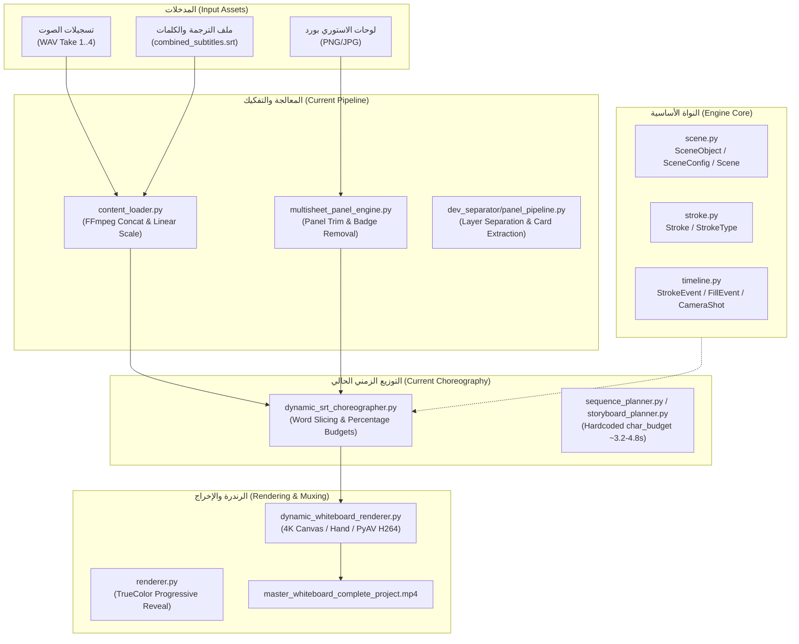

# تقرير التحليل الهندسي الشامل والمعماري
# Audio-Synchronized Animation Timing Engine (ASATE)
## نظام توقيت ومزامنة الرسم الكرتوني مع الصوت البشري

---

**تاريخ الإعداد:** 17 سبتمبر 2026  
**الدور الوظيفي:** Senior Animation Systems Engineer + Storyboard Director + Audio Synchronization Engineer  
**المشروع:** Whiteboard Animation Engine (Offline)  
**الحالة:** المرحلة 1 — التحليل الهندسي المعمق والتصميم المعماري للمحرك  

---

## فهرس المحتويات
1. [المعمارية الحالية للنظام (Current Architecture) وحصر المسؤوليات](#1-المعمارية-الحالية-للنظام-current-architecture)
2. [طريقة حساب التوقيت الحالية (Current Timing Flow) والعيوب الجوهرية](#2-طريقة-حساب-التوقيت-الحالية-current-timing-flow)
3. [أسباب ونقاط عدم التزامن (Root Causes of Desynchronization)](#3-أسباب-ونقاط-عدم-التزامن-root-causes-of-desynchronization)
4. [البيانات المتاحة حالياً والقابلة للاستغلال الفوري](#4-البيانات-المتاحة-حالياً-والقابلة-للاستغلال-الفوري)
5. [البيانات الناقصة لبناء محرك متزامن حقيقي](#5-البيانات-الناقصة-لبناء-محرك-متزامن-حقيقي)
6. [التصميم المعماري المقترح (Proposed ASATE Architecture)](#6-التصميم-المعماري-المقترح-proposed-asate-architecture)
7. [الخوارزمية الرياضية المقترحة لحساب التوقيت (Mathematical Timing & Optimization Algorithm)](#7-الخوارزمية-الرياضية-المقترحة-لحساب-التوقيت)
8. [آلية الربط المتكاملة (Audio + SRT + Elements + Strokes)](#8-آلية-الربط-المتكاملة-audio--srt--elements--strokes)
9. [خطة التنفيذ المرحلية خطوة بخطوة (Phased Implementation Plan)](#9-خطة-التنفيذ-المرحلية-خطوة-بخطوة)
10. [مجموعة اختبارات التحقق والانحدار (Regression Testing Suite)](#10-مجموعة-اختبارات-التحقق-والانحدار)

---

## 1. المعمارية الحالية للنظام (Current Architecture)

من خلال الفحص الجنائي والبرمجي لكافة طبقات الكود في مجلدات المشروع (`kivy/engine/` و `dev_separator/` و `project_content/`)، يتضح أن هيكل النظام مقسم كالتالي:



### جدول حصر المفاهيم والملفات المسؤولة حالياً:

| المفهوم (Concept) | الملف المسؤول حالياً | الوظيفة الفعلية |
| :--- | :--- | :--- |
| **Element** | [`kivy/engine/core/scene.py`](file:///e:/image_to_animate/kivy/engine/core/scene.py), [`dev_separator/semantic_classifier.py`](file:///e:/image_to_animate/dev_separator/semantic_classifier.py) | تمثيل العنصر (`SceneObject`) بخصائصه الهندسية (`bbox`, `mask`, `crop`, `category`). |
| **Stroke** | [`kivy/engine/core/stroke.py`](file:///e:/image_to_animate/kivy/engine/core/stroke.py), [`kivy/engine/render/concentric_engine.py`](file:///e:/image_to_animate/kivy/engine/render/concentric_engine.py) | تمثيل مسار الخط كنقاط إحداثية وحساب الطول التراكمي، وتوليد مسارات التقشير المداري من الخارج للداخل `OUTSIDE_IN`. |
| **Scene / Panel** | [`kivy/engine/core/scene.py`](file:///e:/image_to_animate/kivy/engine/core/scene.py), [`kivy/engine/pipeline/multisheet_panel_engine.py`](file:///e:/image_to_animate/kivy/engine/pipeline/multisheet_panel_engine.py) | تمثيل البانل وتحديد أبعاده ومسح شارات الترقيم واستخراج الأبعاد الداخلية. |
| **Timeline** | [`kivy/engine/core/timeline.py`](file:///e:/image_to_animate/kivy/engine/core/timeline.py) | تجميع أحداث `StrokeEvent` و `FillEvent` و `CameraShot` واسترجاع النشط منها عند كل ثانية. |
| **Animation Duration** | [`kivy/engine/planning/sequence_planner.py`](file:///e:/image_to_animate/kivy/engine/planning/sequence_planner.py), [`kivy/engine/pipeline/dynamic_srt_choreographer.py`](file:///e:/image_to_animate/kivy/engine/pipeline/dynamic_srt_choreographer.py) | حساب مدد رسم العناصر والبانلات. |
| **Audio** | [`kivy/engine/pipeline/content_loader.py`](file:///e:/image_to_animate/kivy/engine/pipeline/content_loader.py) | دمج ملفات WAV عبر FFmpeg وقراءة المدة الإجمالية. |
| **SRT** | [`kivy/engine/pipeline/content_loader.py`](file:///e:/image_to_animate/kivy/engine/pipeline/content_loader.py), [`dev_separator/transcript_timeline_aligner.py`](file:///e:/image_to_animate/dev_separator/transcript_timeline_aligner.py) | تحليل توقيتات الكلمات والأسطر وتحويلها لثوانٍ. |
| **Storyboard** | [`kivy/engine/planning/storyboard_planner.py`](file:///e:/image_to_animate/kivy/engine/planning/storyboard_planner.py) | تنظيم مسارات الكاميرا والتنقل بين البانلات على اللوحة المجمعة. |
| **Renderer** | [`kivy/engine/pipeline/dynamic_whiteboard_renderer.py`](file:///e:/image_to_animate/kivy/engine/pipeline/dynamic_whiteboard_renderer.py), [`kivy/engine/render/renderer.py`](file:///e:/image_to_animate/kivy/engine/render/renderer.py) | إسقاط الحبر تدريجياً، محاكاة حركة اليد والقلم، ودمج الصوت عبر PyAV. |

---

## 2. طريقة حساب التوقيت الحالية (Current Timing Flow)

تعتمد المنظومة الحالية على معادلات توقيت ثابتة وهندسية مجردة، وهي موزعة كالتالي:

### أ) في المحرك القديم (`sequence_planner.py`):
```python
# حساب ميزانية زمنية ثابتة للشخصية بناءً على أطوال الخطوط ومساحة التلوين فقط
char_budget = (3.2 + min(1.6, (total_stroke_len * 0.0003) + (np.sqrt(total_fill_area) * 0.002))) / max(0.2, config.drawing_speed)
```
- **الخلل:** هذه المعادلة تفترض أن كل شخصية يجب أن تستغرق ما بين 3.2 إلى 4.8 ثوانٍ بغض النظر عما إذا كان المعلق يتحدث عنها لمدة ثانية واحدة أو عشر ثوانٍ!

### ب) في مخطط الاستوري بورد (`storyboard_planner.py`):
```python
panel_budget = 4.2 / max(0.2, config.drawing_speed)
char_budget = panel_budget / max(1, len(panel_focal_objs))
```
- **الخلل:** إعطاء كل بانل ميزانية مسطحة مقدارها 4.2 ثانية وتقسيمها بالتساوي على عدد العناصر، وهو ما يعزل الرسوم تماماً عن إيقاع الصوت.

### ج) في المعالج الديناميكي (`dynamic_srt_choreographer.py`):
```python
# تخصيص نسب مئوية ثابتة من مدة البانل المستخرجة من شريحة الكلمات:
if "title" in name or cat == "TITLE":
    o_dur = min(1.8, max(0.4, p_dur * 0.28))
elif cat == "CHARACTER":
    o_dur = min(3.5, max(0.8, p_dur * 0.40))
elif cat == "CONTAINER_CARD":
    o_dur = min(2.0, max(0.5, p_dur * 0.30))
elif cat in ("EMOJI", "ICON_GRAPHIC"):
    o_dur = min(1.5, max(0.4, p_dur * 0.22))
else:
    o_dur = min(2.0, max(0.4, p_dur * 0.25))

t_curr = min(p_end - 0.1, t_curr + o_dur * 0.75) # تداخل هندسي بنسبة 25%
```
- **الخلل:** النسبة المئوية الثابتة تجعل عنصراً بسيطاً يستهلك وقتاً طويلاً بينما يُضغط عنصر معقد جداً في ثوانٍ معدودة.

### د) في رندرة مسار القلم (`dynamic_whiteboard_renderer.py`):
```python
prog = max(0.0, min(1.0, (curr_time - ost) / odur))
s_pts = active_obj["stroke_pts"]
pt_idx = min(len(s_pts) - 1, int(round(prog * (len(s_pts) - 1))))
```
- **الخلل القاتل:** يتم رسم النقاط بنسبة مئوية خطية (`Index-based Linear Interpolation`) من مصفوفة النقاط؛ بحيث تأخذ النقطة الأولى نفس زمن النقطة الأخيرة، دون أي اعتبار لطول الخط الفيزيائي الحقيقي أو سرعة حركة يد الرسام الحقيقية (`Pixels per Second`).

---

## 3. أسباب ونقاط عدم التزامن (Root Causes of Desynchronization)

1. **معضلة القياس الخطي الموحد (Linear Time Rescaling Fallacy):**  
   في [`content_loader.py`](file:///e:/image_to_animate/kivy/engine/pipeline/content_loader.py)، يُحسب معامل التمديد لملف الترجمة بالعلاقة:
   $$\text{time\_ratio} = \frac{\text{total\_audio\_sec}}{\text{raw\_srt\_dur}} = \frac{151.20}{99.00} \approx 1.5273$$
   ويتم ضرب كل توقيت في هذا المعامل. هذا يفترض افتراضاً خاطئاً بأن المتحدث كان بطيئاً بنسبة متجانسة 52% في كل كلمة، بينما الواقع أن الحديث البشري يتأرجح بين السرعة والبطء وتتخلله وقفات سكون (Pauses) بين الجمل والمقاطع؛ مما يؤدي إلى تراكم انزياح زمني (Temporal Drift).

2. **العمى الدلالي بين الكلمة والعنصر (Semantic Blindness):**  
   النظام يجدول العناصر بترتيب فئوي جامد:
   `TITLE -> CHARACTER -> CONTAINER_CARD -> TEXT_LINE`  
   فإذا بدأ المعلق حديثه بشرح البطاقة أو ذكر الرقم قبل ذكر العنوان، فإن الرسم يظل عاجزاً ومقيداً بالترتيب الهيكلي المجرد، مما يُشعر المشاهد بأن الرسم ينفصل عما يُقال في أذنه.

3. **إهدار فترات الصمت البشري (Unutilized Audio Pauses):**  
   فترات السكون في الصوت لا تُستغل إطلاقاً في إنهاء الخطوط أو الانتقال الهادئ بالكاميرا، بل يستمر الرسم بالوتيرة الآلية الصماء، ثم يُفاجأ النظام بعودة الكلام السريع فيضطر لحشر العناصر التالية.

4. **تجاهل كثافة الكلام الموضعية (Speech Density):**  
   لا توجد آلية تقيس عدد الكلمات أو الحروف في الثانية ($\text{Words/Sec}$)؛ فالنظام لا يسرع الرسم عندما يكون الكلام سريعاً ومكثفاً ولا يبطئه حين يكون الكلام متأنياً.

5. **غياب محلل القيود الشامل (No Global Constraint Solver):**  
   لا يوجد نظام يمتلك خاصية النظر للأمام والخلف (Lookahead / Lookbehind) لتقييم الاحتياج الكلي للبانل والمشهد؛ فكل عنصر يقتطع نسبته بجشع دون النظر لاحتياج العنصر المحوري التالي.

---

## 4. البيانات المتاحة حالياً والقابلة للاستغلال الفوري

1. **المقاطع الصوتية المجزأة الأصلية:**  
   المقاطع الـ 4 المنفصلة في `project_content/audio/` قبل الدمج (`4_43PM.wav`, `5_14PM.wav`, `5_16PM.wav`, `5_18PM.wav`) والتي تحدد حدود المشاهد الطبيعية دون أي افتراضات.
2. **ملف الترجمة الزمني الدقيق (Word-level SRT):**  
   330 كلمة بتوقيتها وترتيبها اللغوي الدقيق.
3. **التصنيف الدلالي المتقدم للبانلات:**  
   تصنيف دقيق للعناصر: `CHARACTER`, `CONTAINER_CARD`, `TITLE`, `TEXT_LINE`, `EMOJI`, `ICON_GRAPHIC`.
4. **الأقنعة الدقيقة ومسارات الخطوط الحلقية:**  
   أقنعة ألفا مفرغة للحدود (`Exact Alpha Masks`)، ونقاط مسار خطي من الخارج للداخل `OUTSIDE_IN` لكل عنصر.
5. **مكتبات الحوسبة المتاحة بدون اتصال (Offline Libraries):**  
   متوفر في البيئة الحالية: `numpy`, `scipy` (بما فيها `scipy.signal` و `scipy.io.wavfile`), `av` (PyAV), `cv2` (OpenCV), ومحرك `ffmpeg` مدمج على النظام.

---

## 5. البيانات الناقصة لبناء محرك متزامن حقيقي

1. **مخطط نشاط الصوت (Offline VAD & Silence Map):**  
   فترات الكلام الفعلي، فترات الصمت والوقفات (Pauses)، ومظروف طاقة الإشارة (Energy Envelope) بالملي ثانية.
2. **كثافة الكلام الموضعية (Local Speech Density):**  
   معدل الكلمات/الحروف في الثانية ($\text{Words/Sec}$ و $\text{Chars/Sec}$) لكل نافذة كلامية.
3. **نموذج زمن الخط الفيزيائي (Physical Stroke Arc-length Parametrization):**  
   قياس طول الخط بالبكسل، درجة انحنائه، ونوع الخط (محيط خارجي، تفاصيل داخلية، كتابة يدوية).
4. **طبقة الأحداث الدلالية البصرية (Semantic Animation Events):**  
   تحويل الجملة إلى حدث يربط الكلمات الدالة بالعنصر البصري المماثل.
5. **محلل قيود التوقيت الشامل (Global Constrained Timeline Solver):**  
   خوارزمية ذكية تتفاوض مع الوقت المتاح وتستغل فترات الصمت وتعدل سرعة القلم ضمن الحدود الفيزيائية المسموحة.

---

## 6. التصميم المعماري المقترح (Proposed ASATE Architecture)

فصل كامل بين محلل الصوت والترجمة والتوقيت عن الرندرة، وفق حزمة مستقلة معيارية داخل `kivy/engine/sync/`:

```text
kivy/engine/sync/
├── __init__.py
├── audio/
│   ├── __init__.py
│   ├── audio_analyzer.py          # كشف الصمت والنشاط الصوتي ومظروف الطاقة (Offline VAD)
│   └── energy_envelope.py         # حساب طاقة الإشارة وحساب القمم الصوتية (Energy Peaks)
├── subtitle/
│   ├── __init__.py
│   ├── speech_segment.py          # كائنات بيانات نافذة الكلام ومعدل الحروف
│   └── srt_parser.py              # محلل SRT المتقدم مع تنظيف النصوص العربية
├── semantic/
│   ├── __init__.py
│   ├── animation_event.py         # كائن الحدث الدلالي الرابط بين الكلام والرسم
│   └── semantic_mapper.py         # ربط الكلمات بالمفردات البصرية والتصنيف
├── timing/
│   ├── __init__.py
│   ├── constraints.py             # قيود السرعة والمدد القصوى والدنيا والمسافات
│   ├── duration_model.py          # نموذج حساب مدة العنصر والخط فيزيائياً
│   ├── speech_density.py          # حساب كثافة الكلام وتعديل مستوى التفاصيل
│   └── global_timeline_solver.py  # المحلل الشامل بالنظر للأمام والخلف (Lookahead/behind)
├── timeline/
│   ├── __init__.py
│   ├── synchronized_timeline.py   # التايم لاين الشامل المولد والمتزامن مع الصوت
│   └── quality_evaluator.py       # تقييم جودة المزامنة والتقرير التشخيصي (Quality Score)
└── debug/
    ├── __init__.py
    └── timeline_visualizer.py     # أداة المعاينة البصرية والتشخيص الشامل للتايم لاين
```

---

## 7. الخوارزمية الرياضية المقترحة لحساب التوقيت

### 1. تحليل النشاط الصوتي وكشف الفجوات (Offline VAD via Short-Time Energy):
يتم تقسيم إشارة الصوت $x[n]$ بمعدل عينات $F_s$ إلى نوافذ زمنية متداخلة بطول $W$ وقافز $H$:
$$E[m] = \sqrt{\frac{1}{W} \sum_{k=0}^{W-1} x[m \cdot H + k]^2}$$
يتم تحديد فترات الصمت والوقفات $[t_{\text{start}}, t_{\text{end}}]$ عندما تقل الطاقة $E[m] < \theta_{\text{silence}}$ لمدة تتجاوز $180\text{ ms}$.

### 2. حساب كثافة الكلام (Speech Density):
لكل نافذة كلامية مدتها $\Delta T = t_{\text{end}} - t_{\text{start}}$ تحتوي على $N_w$ كلمة و $N_c$ حرف:
$$\rho_{\text{speech}} = \frac{N_c}{\Delta T} \quad \text{(حرف/ثانية)}$$
معامل تعديل السرعة الناتج عن كثافة النطق:
$$S_{\rho} = \text{clamp}\left(1.0 + \gamma \cdot \frac{\rho_{\text{speech}} - \rho_{\text{nominal}}}{\rho_{\text{nominal}}}, \, 0.75, \, 1.45\right)$$

### 3. نموذج مدة الخط الفيزيائي (Physical Stroke Duration Model):
لكل خط $s_i$ له طول قوسي كلي $L_i = \sum \|\mathbf{p}_{k+1} - \mathbf{p}_k\|$ ومتوسط انحناء $\bar{\kappa}_i$:
$$T_{\text{stroke}}(s_i) = \frac{L_i}{v_{\text{nominal}} \cdot \omega_{\text{type}}} \cdot (1.0 + \beta \cdot \bar{\kappa}_i)$$
حيث:
- $v_{\text{nominal}}$: سرعة اليد الطبيعية بالبكسل في الثانية (Default: $450\text{ px/sec}$).
- $\omega_{\text{type}}$: وزن نوع الخط (1.2 للمحيط الخارجي السريع، 0.8 لكتابة النصوص العربية المعقدة).
- $\beta$: معامل إبطاء المنحنيات الحادة ($\approx 0.25$).

### 4. نموذج مدة العنصر المستهدفة (Element Duration Model):
$$T_{\text{target}}(E) = \text{clamp}\left(\sum_{s \in E} T_{\text{stroke}}(s) \cdot W_{\text{priority}}(E) \cdot S_{\rho}, \, T_{\min}(E), \, T_{\max}(E)\right)$$
مع حدود آمنة قابلة للمعايرة:
- عنصر بسيط (رمز/إيموجي): $[0.4\text{s}, 1.2\text{s}]$
- بطاقة حاوية أو عنوان: $[0.8\text{s}, 2.2\text{s}]$
- شخصية بشرية كاملة: $[1.8\text{s}, 4.5\text{s}]$

### 5. خوارزمية المحلل الشامل بالنظر للأمام والخلف (Global Timeline Solver):
تحل الخوارزمية مسألة التحسين المقيدة التالية:
$$\min \sum_{j} \left( |t_{\text{draw\_end}}(E_j) - t_{\text{speech\_end}}(S_j)| + \lambda \cdot |v_j - v_{\text{nominal}}|^2 \right)$$
خاضعة للشروط:
1. **الاستباق الطبيعي (Anticipation):** يبدأ رسم العنصر الأساسي قبل أو لحظة نطق الكلمة الدالة عليه:
   $$t_{\text{start}}(E_j) \in [t_{\text{word}}(w_j) - \delta_{\text{anticipate}}, \, t_{\text{word}}(w_j)]$$
2. **استغلال فترات الصمت (Pause Utilization):** إذا كانت نافذة الكلام $\Delta T_{\text{speech}} < T_{\text{target}}(E_j)$ وتوجد وقفة صمت تالية $P_{k}$، يتم تمديد الرسم خلال فترة الصمت دون تجاوزها.
3. **مستويات الأولوية وتخفيف التفاصيل (Dynamic LOD Strategy):**
   إذا تجاوز المحتوى الوقت المتاح:
   - الحفاظ على زمن العنصر الأساسي (`PRIMARY`) بنسبة 100%.
   - تسريع أو تقليص مسارات التظليل الداخلي في العنصر الثانوي (`SECONDARY`).
   - ضغط أو تأجيل العناصر الزخرفية (`DECORATIVE`).

---

## 8. آلية الربط المتكاملة (Audio + SRT + Elements + Strokes)

```text
[ ملف الصوت WAV ]
        │
        ├──────────► [ كشف فترات الصمت والوقفات الفاصلة (Silence Pauses) ]
        │
[ ملف الترجمة SRT ]
        │
        ├──────────► [ نوافذ الكلام والكلمات الدلالية (Speech Windows) ]
        │                       │
        ▼                       ▼
[ ربط المعنى بالرسم: SemanticMapper ]
        │
        ├──────► حدث بصري 1: رسم الشخصية بالتزامن مع عبارة التقديم (0.0s -> 1.8s)
        ├──────► حدث بصري 2: رسم العنوان بالتزامن مع نطق المصطلح (1.8s -> 2.6s)
        ├──────► حدث بصري 3: استغلال فترة الصمت (0.4s) لإكمال حدود البطاقة
        └──────► حدث بصري 4: كتابة الأرقام بالتزامن مع ذكر الإحصائية
                                │
                                ▼
        [ توزيع الوقت على الخطوط الفردية بطول القوس الحقيقي ]
                                │
                                ▼
        [ رندرة اليد والقلم بسرعة حركة بكسلية فيزيائية طبيعية ]
```

---

## 9. خطة التنفيذ المرحلية خطوة بخطوة (Phased Implementation Plan)

### المرحلة 1: إنشاء كائنات البيانات ومحلل الصوت غير المتصل (Audio Analyzer & VAD)
- بناء كائنات البيانات `SpeechSegment` و `AnimationEvent`.
- تنفيذ `audio_analyzer.py` باستخدام `scipy` لقراءة الإشارة وحساب فترات الصمت ونشاط الصوت (VAD) بالملي ثانية.

### المرحلة 2: بناء نموذج كفاءة الخط وحساب المدد الفيزيائية (Duration Model & Stroke Physics)
- تطبيق قياس الطول القوسي الحقيقي والانحناء لكل خط في `concentric_engine.py` و `stroke.py`.
- بناء `duration_model.py` وتحديد سرعة البكسل في الثانية للرسم الطبيعي.

### المرحلة 3: بناء المحلل الشامل المتكيف (Global Timeline Solver)
- تنفيذ خوارزمية Lookahead / Lookbehind لربط نوافذ الصوت بالعناصر.
- برمجة استراتيجيات التكيف (A/B/C/D) في حال كان الكلام سريعاً أو بطيئاً واستغلال فترات الصمت.

### المرحلة 4: ربط المحرك بالرندرة (Whiteboard Renderer Integration)
- استبدال التدرج الخطي الفهرسي في `dynamic_whiteboard_renderer.py` بنظام تتبع طول القوس الفيزيائي (`Arc-length Parameterized Interpolation`).
- ضمان تحرك اليد والقلم بسرعة ثابتة متسقة فيزيائياً مع الكلام.

### المرحلة 5: بناء أدوات التشخيص ومقياس الجودة البصري (Debugger & Quality Scorer)
- إنشاء `timeline_visualizer.py` لتصدير مخطط بياني يوضح على خط زمني واحد:
  - الموجة الصوتية (Audio Waveform)
  - نوافذ الـ SRT
  - أحداث الرسم (Elements Timeline)
  - فترات الصمت المستغلة

---

## 10. مجموعة اختبارات التحقق والانحدار (Regression Testing Suite)

لضمان عدم حدوث أي تراجع في الجودة الحالية، سيتم تضمين الاختبارات الآلية التالية:

1. **اختبار سلامة المدة الكلية (Duration Invariance Test):**
   - التحقق من أن: $|\text{Timeline Duration} - \text{Master Audio Duration}| < \frac{1}{\text{FPS}}$ (أي خطأ أقل من إطار واحد).
2. **اختبار استغلال الصمت (Silence Boundary Adherence Test):**
   - التأكد من عدم انتهاك فترات الصمت الرئيسية أو بدء عناصر غير منطقية في أوقات السكون التام.
3. **اختبار الحدود الفيزيائية لسرعة القلم (Pen Velocity Sanity Check):**
   - التأكد من أن سرعة القلم لجميع العناصر تقع دائماً داخل النطاق الطبيعي:
   $$200\text{ px/sec} \le v_{\text{pen}} \le 1200\text{ px/sec}$$
   ومنع حدوث قفزات لحظية غير مرئية.
4. **اختبار حساسية كثافة الكلام (Speech Density Sensitivity Test):**
   - تغذية مقطع بطيء ومقطع سريع والتحقق آلياً من أن النظام عدل مستوى التفاصيل والسرعة تلقائياً.
5. **مقياس جودة التزامن (Synchronization Score > 85/100):**
   - فحص آلي يحسب التوافق الزمني بين الكلمات المفتاحية وظهور عناصرها الدلالية.

---
**نهاية وثيقة التحليل والتصميم المعماري للمرحلة 1.**
