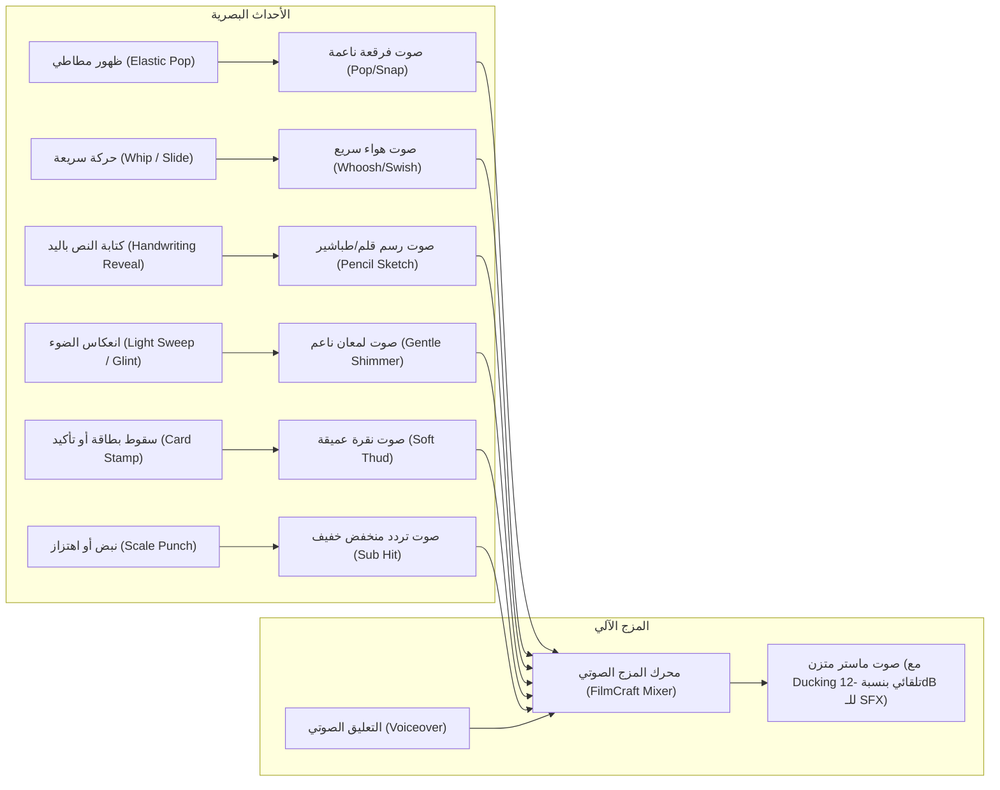

Listed directory image_to_animate
Listed directory craftApp
Listed directory effectcraft
Listed directory filmcraft
Listed directory vectorcraft
Viewed README.md:1-60
Viewed README.md:1-45
Viewed README.md:1-45
Viewed README.md:1-45
Viewed README.md:1-50
Listed directory craftApp
Listed directory filmcraft
Listed directory crates
Listed directory crates
Listed directory crates
Ran command: `Get-ChildItem -Path e:\image_to_animate\craftApp -Recurse -Filter "*.exe" | Select-Object FullName, Length`
Ran command: `Get-ChildItem -Path e:\image_to_animate\craftApp\effectcraft\target\release -Filter "*.exe" | Select-Object Name, Length`
Ran command: `& e:\image_to_animate\craftApp\effectcraft\target\release\effectcraft-cli.exe --help`
Viewed Cargo.toml:1-60
Listed directory apps
Viewed main.rs:1-100
Ran command: `Test-Path e:\image_to_animate\craftApp\filmcraft\target\release\filmcraft-cli.exe`
Listed directory photocraft
Listed directory apps
Listed directory apps
Listed directory apps
Ran command: `Get-ChildItem -Path e:\image_to_animate\craftApp -Recurse -Filter "*-cli.exe" | Select-Object FullName`
Viewed effectcraft_director.py:1-100
Searched for "add-solid"
Searched for "background"
Viewed effectcraft_director.py:400-500
Viewed effectcraft_director.py:330-380
Viewed director_effects_suite.py:1-80
Ran command: `Get-ChildItem -Path e:\image_to_animate\assets -Recurse`
Ran command: `Get-ChildItem -Path e:\image_to_animate\craftApp -Recurse -Directory -Filter "assets" | Select-Object FullName`
Listed directory assets
Listed directory assets
Listed directory audio-dsp
Viewed README.md:1-60

بناءً على قراءة عميقة وشاملة لمنظومة **`craftApp`** (التي تضم 5 محركات مكتوبة بلغة Rust فائقة الأداء: **EffectCraft, FilmCraft, PhotoCraft, VectorCraft, LightCraft**)، ومقارنتها بالبنية الحالية لمشروعنا، خرجنا برؤية معمارية متكاملة لإنشاء **النسخة التجريبية القادمة (Next-Gen v7)** لتحقيق قفزة نوعية في: **السرعة، السهولة، جماليات الإخراج، الخلفيات غير البيضاء، والتزامن الصوتي البصري**.

---

### 1. ماذا نستبدل من مشاريع `craftApp`؟ (خريطة الترقية)

| الجزء الحالي في المشروع | عيوبه / حدوده الحالية | البديل المقترح من `craftApp` | القيمة المضافة ومردود الاحترافية |
| :--- | :--- | :--- | :--- |
| **1. مخرج ومحرك التحريك (Compositing Engine)** | يعتمد على توليد كود مبسط وخلفية بيضاء مصمتة ثابتة دون استغلال كامل قدرات الكانفاس. | **`effectcraft-cli` + محرك الـ Composition Graph** | **إمكانيات غير محدودة**: دعم الخلفيات الديناميكية، التدرجات اللامعة، الجرافيك ثلاثي الأبعاد، واستغلال بطاقة الرسوميات (GPU) في الريندر الفوري بدلاً من المعالجة البرمجية البطيئة. |
| **2. المونتاج والدمج النهائي (Editing & Mixing)** | كان يعتمد على FFmpeg concat البسيط الذي يدمج المشاهد خطياً دون مسارات احترافية أو انتقالات ناعمة. | **`filmcraft-cli` ومحرك `filmcraft-audio-dsp`** | **محرك NLE متعدد المسارات (Multi-Track Timeline)**: مسار فيديو + مسار تعليق صوتي + مسار مؤثرات صوتية (SFX) + مسار موسيقى تصويرية، مع ميزة التخفيض التلقائي للصوت (Sidechain Audio Ducking). |
| **3. استخراج العناصر من الاستوريبورد (Extraction & Masking)** | تقطيع OpenCV التقليدي على البكسل الأبيض، مما يترك حوافاً بيضاء باهتة تمنع وضع العنصر على خلفية ملونة أو داكنة. | **مفاهيم `photocraft-compose` و `vectorcraft`** | **معالجة حواف ذكية (Alpha Edge Feathering)** وأنماط دمج مثل **`Multiply`** (التي تجعل الورق الأبيض يندمج فوراً في أي خلفية ملونة أو ورقية دون أي قص مزعج أو هالات بيضاء). |
| **4. معالجة الصوت والماسترينج (Audio Mastering)** | صوت الفويس أوفر خام بدون معالجة ترددية أو ضبط لمستويات الصوت القياسية. | **`filmcraft-audio-dsp`** | **ماسترينج إذاعي فوري**: تطبيق (Enhance Speech + De-esser + Limiter) وتوحيد مستوى الصوت وفق المعايير العالمية (EBU R128 / -16 LUFS). |

---

### 2. التحرر من الخلفية البيضاء (Dynamic Visual Themes)

السبب الذي جعل الفيديو سابقاً يلتزم بالأبيض هو أن الرسومات المستخرجة من الاستوريبورد خلفيتها بيضاء. لحل ذلك بصرياً وبشكل احترافي جداً، نعتمد في **النسخة التجريبية** 4 ثيمات جديدة:

1. **ثيم الورق المنسوج الطبيعي (Warm Textured Canvas / Parchment)**:
   - خلفية ورقية عاجية دافئة (`#F7F5EE` أو `#F1EBE1`) مع تظليل خفيف جداً للأطراف (Vignette).
   - استخدام نمط دمج **`Multiply Blend Mode`**: يجعل بياض الرسمة يختفي طبيعياً وتظهر خطوط الحبر كأنها مرسومة بالريشة فوق الورق الفاخر.
2. **ثيم المخطط العلمي والسبورة الداكنة (Dark Slate / Blueprint / Blackboard)**:
   - خلفية كحلية/رمادية داكنة فاخرة (`#141923` أو `#1C222D`) مع شبكة نقاط هندسية دقيقة (Isometric Grid Dots).
   - قلب خطوط الرسم (Invert Ink) لتصبح خطوطاً بيضاء وطباشيرية مضيئة مع توهج نيون ناعم (Neon Chalk).
3. **ثيم الاستوديو السينمائي بتدرج ناعم (Cinematic Studio Vignette)**:
   - تدرج لوني شعاعي ناعم في المركز (Radial Soft Gradient) بألوان تتكيف مع موضوع المشهد (مثلاً: أزرق طبي للأعضاء والخلايا، عنبري دافئ للحياة والنمو).
4. **خلفيات تفاعلية (Dynamic Background Plates)**:
   - إمكانية إدراج أي صورة خلفية عالية الدقة أو فيديو خفيف كخلفية مستمرة يتحرك الرسم فوقها.

---

### 3. هندسة المؤثرات الصوتية المتزامنة مع البصريات (Audiovisual SFX)

لتحويل الفيديو من مجرد رسوم متحركة إلى **تجربة حسية كاملة**، نضيف محرك **`SoundFX Dispatcher`** المتزامن بالمللي ثانية مع كل حركة بصرية:

**قواعد ضبط الصوت:**
- **أولوية الفويس أوفر (Vocal Primacy):** المؤثر الصوتي لا يتجاوز مستوى الصوت البشري أبداً، بل يُعزف عند مستوى متوازن منخفض (-14dB إلى -18dB) ليعطي إيحاء اللمس والحركة دون أي تشويش.
- **التوقيت الدقيق (Sub-frame Alignment):** يبدأ المؤثر الصوتي قبل ذروة الحركة بـ 30 مللي ثانية ليطابق الإدراك البشري للعين والأذن معاً.

---

### 4. خطة العمل المقترحة للنسخة التجريبية (Next-Gen Pilot)

للبدء العملي دون المساس بالمشروع الحالي المكتمل بنجاح:
1. **إنشاء مجلد معزول للنسخة التجريبية (`v7_experimental`)**.
2. **تجهيز مكتبة المؤثرات الصوتية النقية (Clean SFX Library)**: (Whooshes, Pops, Pencil Scratches, Gentle Glints).
3. **تطوير محرك الخلفيات المتقدم في `effectcraft_director.py`**: يتيح تمرير متغير الثيم (مثلاً: `theme="warm_paper"` أو `theme="dark_blueprint"`).
4. **تطبيق تجريبي على مشهد واحد (Pilot Scene)**: ريندر مشهد اختباري كامل يدمج:
   - خلفية الورق الطبيعي/السبورة الداكنة.
   - التحريك المطور من EffectCraft.
   - المؤثرات الصوتية المتزامنة تماماً مع كل حركة بصرية.

هل تفضل أن نبدأ بتجهيز هذا المشهد التجريبي لنشاهده ونسمع النتيجة معاً؟ وأي نمط خلفية تود تجربته أولاً (الورق الطبيعي الدافئ أم السبورة العلمية الداكنة)؟